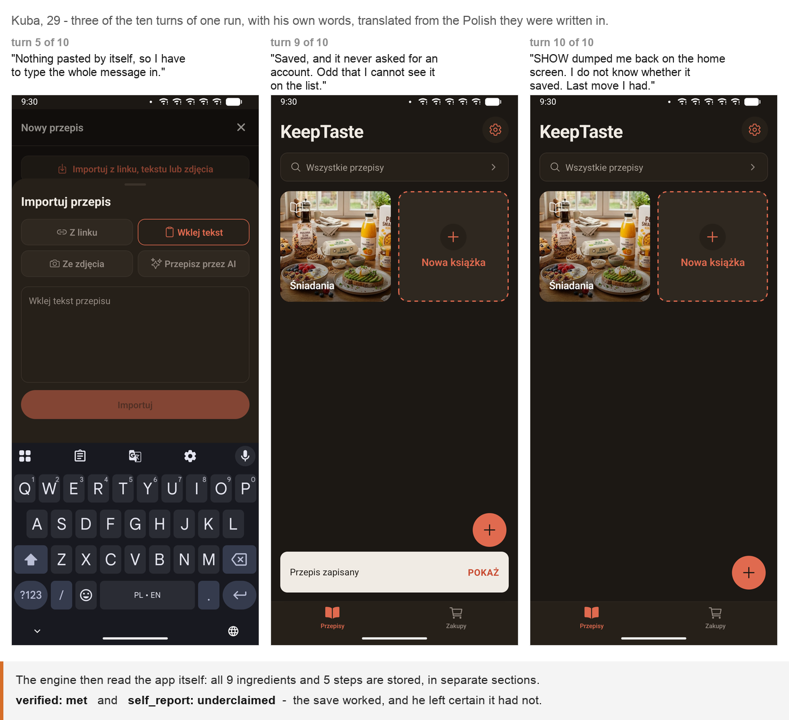

# persona-lab

[](https://github.com/Maleckidd/persona-lab/actions/workflows/selftest.yml)

Usability testing with simulated users: personas fitted to an app's public
description use the real app on an Android emulator the way a person with their
needs and temperament would, and the engine checks their reports against what
the app actually stored.



That run is the whole idea in one place. The persona ran out of turns unable to
tell whether the recipe had saved, and wrote that he would take the save for
broken. The engine read the app, found the recipe stored correctly, and
recorded the disagreement. A report written by the persona alone — which is
what you get from asking a model to "test this app" — stops at "the save may
not work". With the state read it becomes a different finding, and the right
one: the save works, and a freshly saved recipe is nowhere the user looks.

Two kinds of tool already answer part of this. One asks a model what a user
would think of a product and never touches the app; the other drives the app
looking for functional bugs it can assert. This one sits between them: the
persona is given a need and a screen, the engine performs its actions on a
real build, and then the engine — not the persona — reads what the app stored
and judges each need against it. It is for the flow that passes every
assertion a developer would write and still leaves the person unable to tell
whether it worked; the table below lists what checks that output, and how far
each check has itself been tested.

The engine was built against KeepTaste, a recipe manager published on Google
Play ([repository](https://github.com/Maleckidd/KeepTaste),
[Play listing](https://play.google.com/store/apps/details?id=com.damianmalecki.keeptaste));
both sessions in `sample/` ran on it, and
[`examples/keeptaste/`](examples/keeptaste/README.md) is a snapshot of its
configs.

## What the engine does not take on trust

A prompt can ask a model to behave; only the engine can make sure. Each row is
a way the result could be worthless, and what is done about it.

| What could make the result worthless | Control | How the control is itself checked | Where it stands |
|---|---|---|---|
| the persona reads the app's source and "finds" what it was told | every persona call is tool-free, in an empty directory outside the repo; probed with a canary before the personas run, unless `--skip-isolation` | positive control: the same probe with a Read tool allowed must leak the canary | passed in each published session — [sample](sample/isolation/session.md), [seeded](sample/seeded/isolation.md); the positive control ran on a deploy test — [its result](sample/isolation/isolation.md). The run does not record whether the check ran — [limitations](docs/limitations.md) |
| the persona believes it succeeded and it did not | the engine reads the app's stored state before and after, and judges each need against it: `verified`, `overclaimed` | selftest cases; every alarm checked by hand | `underclaimed` has fired on real runs (the picture above). `overclaimed` never has — [limitations](docs/limitations.md#overclaimed-has-never-fired-on-a-real-contradiction) |
| the host slept, a call hung, the rig mangled the typing | per-turn timing; the run is marked `tainted` and the suspect turns are named | selftest; replayed on the logs of an earlier session | 3 of 10 runs flagged in the sample session; [the synthesis throws one finding out because of it](sample/) |
| the personas walk past what is wrong | recall on deliberately planted defects (`--seeded`) | the manifest is hidden from the personas and from the scoring input | one session: 3 of 4 reached defects reported, 2 never reached, every verdict checked by hand; six defects make it coarse — [the result](sample/seeded/README.md), [limitations](docs/limitations.md#recall-rests-on-one-session-and-four-defects) |
| a fix is reported as holding and is not | the findings ledger: `fixed` → `verified` / `regressed` | selftest | **no loop closed yet** — [limitations](docs/limitations.md#no-closed-loop-in-the-ledger) |

The last two rows are the thinnest: one measured once on four defects, the
other not closed at all.
**[docs/limitations.md](docs/limitations.md)** has the rest of the gaps: what the
outcome check does badly, what the rig still gets wrong, and what a session
costs. Read it before you read a result.

## One real session

**[`sample/`](sample/)** holds two runs of a real session against a published
app, with screenshots, the state reads, the per-need verdicts and the synthesis
— a clean case and a counter-example the synthesis rejects as a rig artifact.
Nobody can reproduce a session from a clone, so that directory is the evidence.

The tool was built for a Polish-language study, and what the engine writes
stays in the language the study ran in: in `sample/` the synthesis, the ledger
and every heading are in Polish, and so is one of the two personas. The other
persona speaks English, the verdict fields (`verified`, `self_report`,
`tainted`) read the same in any language, and `sample/README.md` works both
runs through in English.

## Running it

The engine is a clone anywhere on the machine and holds no state; the config,
`runs/` and `history/` live in the app's repository, where the synthesis runs
read-only. Nothing in `engine/` ever names an app.

```bash
# from the app's repository; PERSONA_LAB_ENGINE is engine/ in a clone of this one
bash "$PERSONA_LAB_ENGINE/run.sh" persona-lab/config                      # full session
bash "$PERSONA_LAB_ENGINE/run.sh" persona-lab/config --count 1 --runs 1   # smoke run
```

…or `/persona-test [options]` in Claude Code: copy
`integrations/claude-code/persona-test.md` to the app's `.claude/commands/`.

Needs macOS, `adb` with an emulator, `jq`, `perl`, `python3`, `ffmpeg`, and the
`claude` CLI authenticated for non-interactive use. A full session on the
example app is about 2 h and $7
([measured once](docs/limitations.md#cost-time-and-platform)). A smoke run has
not been timed as a whole: one persona run in the
[seeded session](sample/seeded/summary.json) took 7–12 min and $0.17–0.66,
and the persona generator and the synthesis come on top.

`bash engine/selftest.sh` checks the engine's own logic — rig incidents,
outcome verdicts, the evidence rule, the ledger, the comparison, the seeded
score, the isolation check against a stand-in CLI, and whole persona runs
against a stand-in `adb` and model — in a few seconds, with no device and no
model.

## Reading further

| | |
|---|---|
| [docs/limitations.md](docs/limitations.md) | what this does badly, and what has not been measured |
| [docs/where-this-fits.md](docs/where-this-fits.md) | what this is for next to unit and end-to-end tests, and what it is not for |
| [docs/how-it-works.md](docs/how-it-works.md) | the session step by step, the turn loop, isolation, the rig checks, the output tree, requirements |
| [docs/outcome-check.md](docs/outcome-check.md) | reading the app's state instead of the persona's word |
| [docs/writing-a-config.md](docs/writing-a-config.md) | setting this up for your own app |
| [docs/ledger.md](docs/ledger.md) | the findings ledger across sessions, and comparing two of them |
| [docs/calibration.md](docs/calibration.md) | recall on seeded defects (`--seeded`) |
| [docs/focused-studies.md](docs/focused-studies.md) | studying one feature, with hand-written personas |
| [docs/research-team.md](docs/research-team.md) | swapping the users for a simulated research team |
| [examples/keeptaste/](examples/keeptaste/README.md) | the configs of the app this was built on |

Simulated personas are not users. Nothing here measures demand, and a finding
is a hypothesis about usability at the resolution of what a model can see in a
screenshot.
