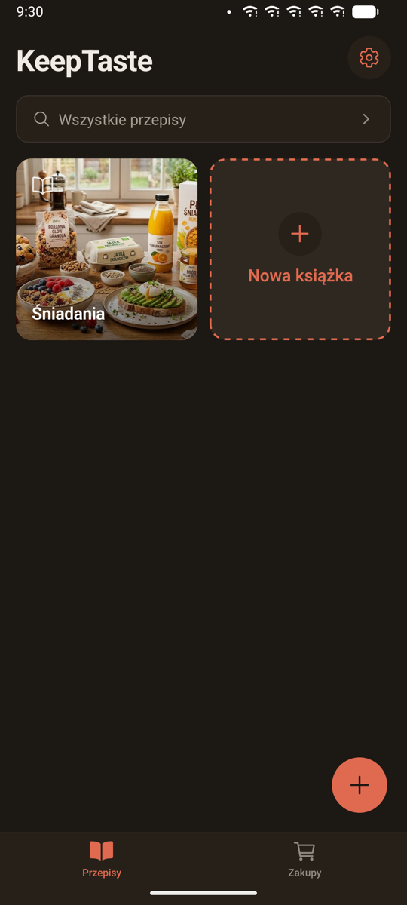
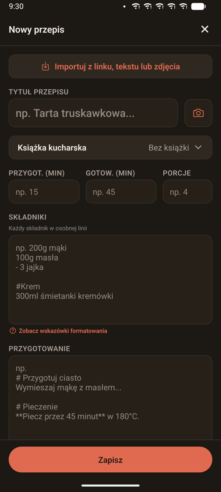
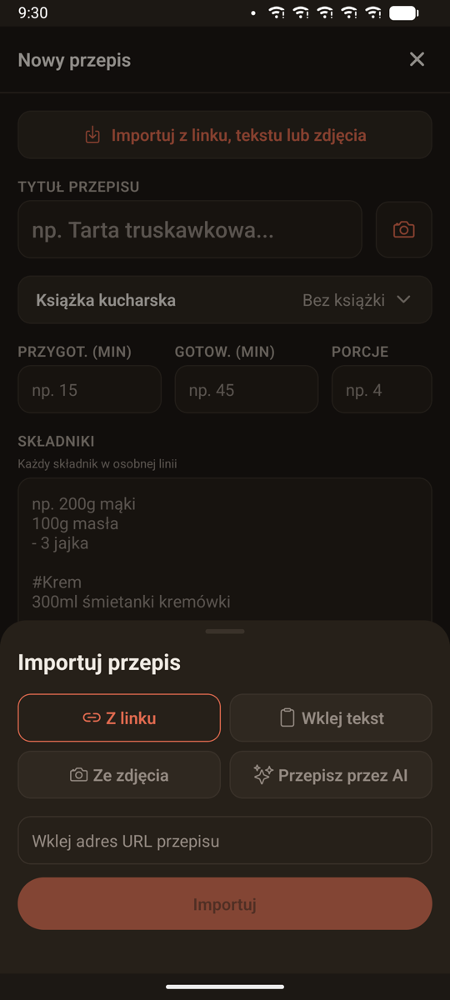
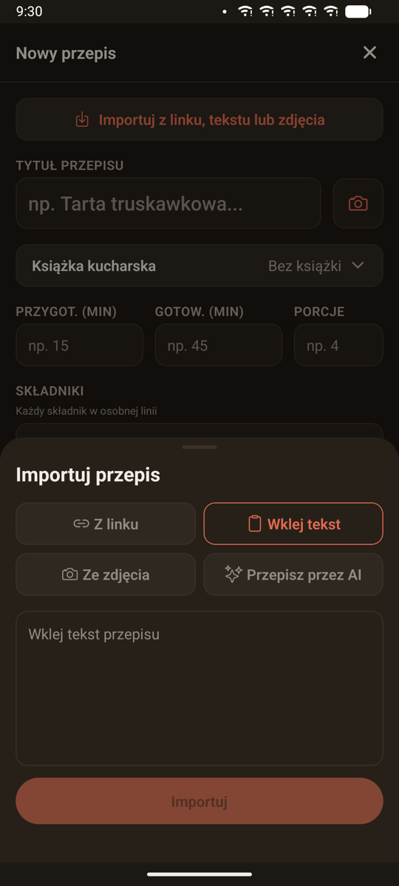
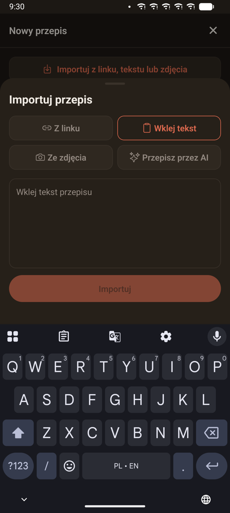
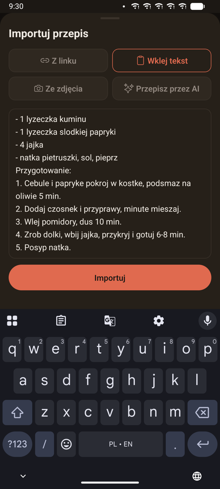
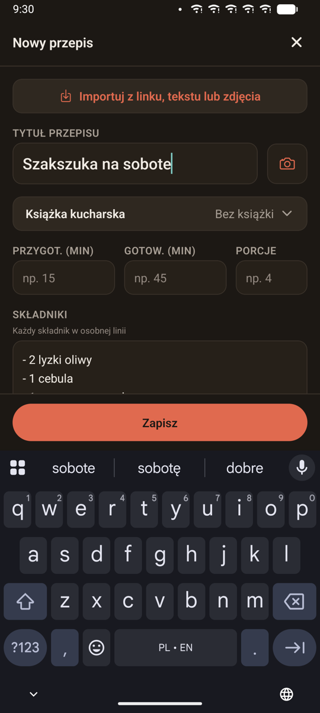
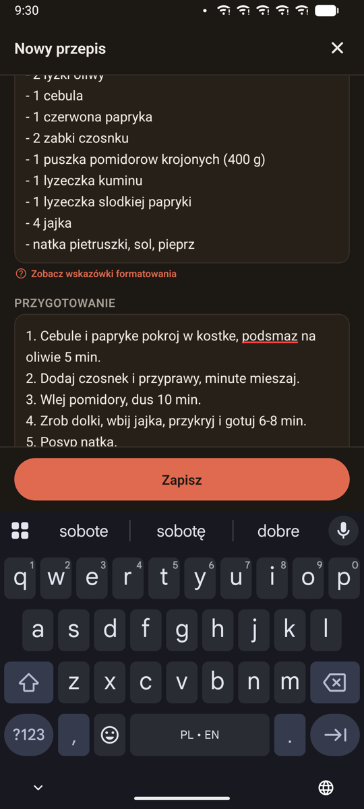
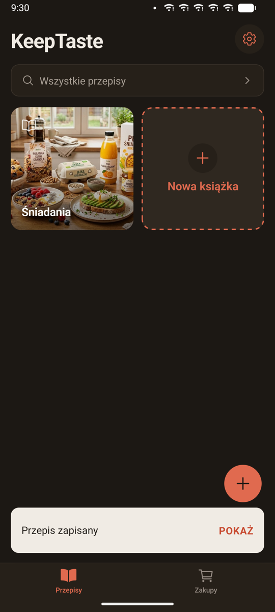

# Think-aloud — Raport: Kuba, 29 — przebieg 1

_Każdy krok: zrzut ekranu, który persona widziała → jej notatki → akcja wykonana przez silnik._

## shot-001

- **Co widzę:** Główny ekran bez onboardingu: nagłówek KeepTaste, wyszukiwarka, kafelek książki 'Śniadania', 'Nowa książka', na dole zakładki Przepisy i Zakupy. Pomarańczowy plus w prawym dolnym rogu.
- **Czego oczekuję:** Plus powinien dać opcje dodania przepisu, np. wklejenie tekstu.
- **Co robię:** Tapuję duży pomarańczowy plus w prawym dolnym rogu, żeby dodać przepis.
- **Co mnie zaskoczyło:** Pozytywnie: żadnego konta ani powitalnych ekranów.
- **Potrzeba:** Zapisać przepis na szakszukę ze schowka, składniki i kroki osobno; sprawdzić, czy czegoś ode mnie chcą.
- **Akcja:** `{"type":"tap","x":477,"y":1041}` → stuknięcie w (477, 1041)

## shot-002

- **Co widzę:** Formularz Nowy przepis: u góry przycisk 'Importuj z linku, tekstu lub zdjęcia', pola tytuł, książka, czasy, składniki, przygotowanie, na dole Zapisz.
- **Czego oczekuję:** Przycisk importu pozwoli wkleić tekst i sam rozdzieli składniki i kroki.
- **Co robię:** Tapuję 'Importuj z linku, tekstu lub zdjęcia', bo mam skopiowaną wiadomość i nie chcę przepisywać pól ręcznie.
- **Co mnie zaskoczyło:** Pole składników i przygotowania wygląda na ręczne wpisywanie, ale jest import u góry, więc próbuję tego.
- **Potrzeba:** Zapisać przepis ze schowka, składniki i kroki osobno.
- **Akcja:** `{"type":"tap","x":270,"y":162}` → stuknięcie w (270, 162)

## shot-003

- **Co widzę:** Otworzył się dolny panel 'Importuj przepis' z czterema opcjami: Z linku (zaznaczone), Wklej tekst, Ze zdjęcia, Przepisz przez AI. Poniżej pole na URL i przycisk Importuj.
- **Czego oczekuję:** Wklej tekst pokaże pole na tekst albo od razu weźmie ze schowka i rozdzieli składniki i kroki.
- **Co robię:** Tapuję 'Wklej tekst', bo mam wiadomość od dziewczyny w schowku, a nie link.
- **Co mnie zaskoczyło:** Domyślnie zaznaczone jest 'Z linku', a nie tekst, trochę dziwne, ale opcje są czytelne.
- **Potrzeba:** Zapisać przepis na szakszukę ze schowka tak, żeby składniki i kroki były osobno.
- **Akcja:** `{"type":"tap","x":396,"y":861}` → stuknięcie w (396, 861)

## shot-004

- **Co widzę:** Panel Importuj przepis z zaznaczonym 'Wklej tekst', duże pole 'Wklej tekst przepisu' i przycisk Importuj (przyciemniony, nieaktywny). Pole jest puste.
- **Czego oczekuję:** Po stuknięciu w pole wklejam tekst ze schowka (lub wpisuję go) i Importuj się aktywuje.
- **Co robię:** Tapuję w pole 'Wklej tekst przepisu', żeby dostało fokus i móc wkleić wiadomość od dziewczyny.
- **Co mnie zaskoczyło:** Nic nie wkleiło się samo ze schowka, trzeba ręcznie, ale to akceptowalne.
- **Potrzeba:** Zapisać szakszukę ze składnikami i krokami osobno.
- **Akcja:** `{"type":"tap","x":270,"y":930}` → stuknięcie w (270, 930)

## shot-005

- **Co widzę:** Panel Importuj przepis z zaznaczonym 'Wklej tekst', puste pole, na dole klawiatura. Importuj nadal przyciemniony. Pole ma chyba fokus, bo wyskoczyła klawiatura. Nic nie wkleiło się ze schowka.
- **Czego oczekuję:** Wpisanie tekstu przepisu aktywuje Importuj, a potem aplikacja rozdzieli składniki i kroki.
- **Co robię:** Wpisuję tekst wiadomości od dziewczyny w pole, bo schowka nie mogę wkleić inaczej niż przez test klawiaturę.
- **Co mnie zaskoczyło:** Nic się nie wkleiło samo, trzeba ręcznie. Trochę drażni, ale idę dalej.
- **Potrzeba:** Zapisać szakszukę ze składnikami i krokami osobno.
- **Akcja:** `{"type":"type","text":"Szakszuka na sobote\nSkladniki:\n- 2 lyzki oliwy\n- 1 cebula\n- 1 czerwona papryka\n- 2 zabki czosnku\n- 1 puszka pomidorow krojonych (400 g)\n- 1 lyzeczka kuminu\n- 1 lyzeczka slodkiej papryki\n- 4 jajka\n- natka pietruszki, sol, pieprz\nPrzygotowanie:\n1. Cebule i papryke pokroj w kostke, podsmaz na oliwie 5 min.\n2. Dodaj czosnek i przyprawy, minute mieszaj.\n3. Wlej pomidory, dus 10 min.\n4. Zrob dolki, wbij jajka, przykryj i gotuj 6-8 min.\n5. Posyp natka."}` → wpisano tekst: Szakszuka na sobote
Skladniki:
- 2 lyzki oliwy
- 1 cebula
- 1 czerwona papryka
- 2 zabki czosnku
- 1 puszka pomidorow krojonych (400 g)
- 1 lyzeczka kuminu
- 1 lyzeczka slodkiej papryki
- 4 jajka
- na

## shot-006

- **Co widzę:** Pole z wpisanym tekstem przepisu, widać koniec: składniki i kroki 1-5. Przycisk Importuj jest teraz pomarańczowy, aktywny, nad klawiaturą.
- **Czego oczekuję:** Po tapnięciu Importuj aplikacja rozdzieli składniki i kroki do formularza, żebym mógł sprawdzić i zapisać.
- **Co robię:** Tapuję pomarańczowy przycisk Importuj.
- **Co mnie zaskoczyło:** Importuj się aktywował, tekst jest cały w polu. Żadnych pytań o konto czy zgody, na razie dobrze.
- **Potrzeba:** Zapisać przepis tak, żeby składniki i kroki były osobno.
- **Akcja:** `{"type":"tap","x":270,"y":681}` → stuknięcie w (270, 681)

## shot-007

- **Co widzę:** Formularz Nowy przepis wypełniony: tytuł 'Szakszuka na sobote', składniki jako lista w osobnych liniach. Klawiatura zasłania dół, widzę przycisk Zapisz. Kroków przygotowania nie widzę, są pewnie niżej pod klawiaturą.
- **Czego oczekuję:** Po Zapisz przepis ląduje w bibliotece. Wolałbym najpierw sprawdzić, czy kroki też się rozdzieliły.
- **Co robię:** Przewijam formularz w dół, żeby zobaczyć pole przygotowania, zanim zapiszę.
- **Co mnie zaskoczyło:** Pozytywnie: import sam rozdzielił tytuł i składniki, bez ręcznego przepisywania. Czasy zostały puste, ale ich nie podałem w tekście.
- **Potrzeba:** Zapisać przepis ze składnikami i krokami osobno.
- **Akcja:** `{"type":"scroll","direction":"down"}` → przewinięcie (down)

## shot-008

- **Co widzę:** Formularz: składniki jako lista w osobnych liniach, pod nimi PRZYGOTOWANIE z krokami 1-5 osobno. Na dole pomarańczowy przycisk Zapisz nad klawiaturą.
- **Czego oczekuję:** Po Zapisz przepis ląduje w bibliotece, bez pytań o konto czy płatność.
- **Co robię:** Kroki są rozdzielone jak trzeba, więc tapuję Zapisz.
- **Co mnie zaskoczyło:** Pozytywnie: import rozdzielił składniki i kroki bez ręcznej roboty, szybciej niż zrzut ekranu.
- **Potrzeba:** Zapisać przepis ze składnikami i krokami osobno.
- **Akcja:** `{"type":"tap","x":270,"y":711}` → stuknięcie w (270, 711)

## shot-009

- **Co widzę:** Wróciłem na główny ekran, na dole pasek 'Przepis zapisany' z przyciskiem POKAŻ. Nie widzę nowego przepisu na liście, tylko książkę Śniadania.
- **Czego oczekuję:** POKAŻ otworzy zapisany przepis, więc sprawdzę, czy składniki i kroki są osobno.
- **Co robię:** Tapuję POKAŻ, żeby zobaczyć zapisany przepis.
- **Co mnie zaskoczyło:** Zapisało się bez żadnych pytań o konto, zgody czy płatności, pozytywnie. Trochę dziwne, że przepisu nie widać na liście, ale pewnie jest w 'Wszystkie przepisy'.
- **Potrzeba:** Sprawdzenie, czy przepis zapisał się z osobnymi składnikami i krokami; brak konta/zgód/płatności.
- **Akcja:** `{"type":"tap","x":463,"y":1040}` → stuknięcie w (463, 1040)

## shot-010

- **Co widzę:** Znowu główny ekran: książka Śniadania, Nowa książka, plus. POKAŻ nie otworzyło przepisu, a zapisanego przepisu nie widać na liście. Został mi ostatni ruch.
- **Czego oczekuję:** Przepis powinien być w 'Wszystkie przepisy', więc tapnę pasek wyszukiwania, żeby to sprawdzić.
- **Co robię:** Tapuję pasek 'Wszystkie przepisy' u góry, żeby zobaczyć, czy szakszuka tam jest.
- **Co mnie zaskoczyło:** POKAŻ wyrzuciło mnie na ekran główny zamiast do przepisu, a nowego przepisu nie widać. Trochę mylące, nie wiem, czy się zapisał.
- **Potrzeba:** Sprawdzenie, czy przepis z osobnymi składnikami i krokami faktycznie jest zapisany.
- **Akcja:** `{"type":"tap","x":270,"y":158}` → stuknięcie w (270, 158)

