# Think-aloud — Raport: Sophie, 34 — przebieg 2

_Każdy krok: zrzut ekranu, który persona widziała → jej notatki → akcja wykonana przez silnik._

## shot-001

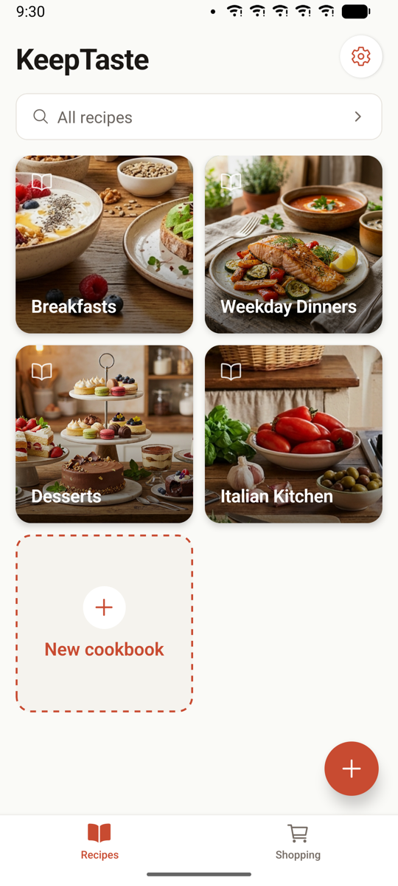

- **Co widzę:** Home screen with cookbook tiles: Breakfasts, Weekday Dinners, Desserts, Italian Kitchen, and a dashed 'New cookbook' tile. A red plus button bottom right.
- **Czego oczekuję:** Tapping 'New cookbook' will let me name a new cookbook.
- **Co robię:** I'm tapping the big 'New cookbook' tile to start the Mum's 60th cookbook.
- **Potrzeba:** Create the cookbook named "Mum's 60th – Family Recipes".
- **Akcja:** `{"type":"tap","x":141,"y":860}` → stuknięcie w (141, 860)

## shot-002

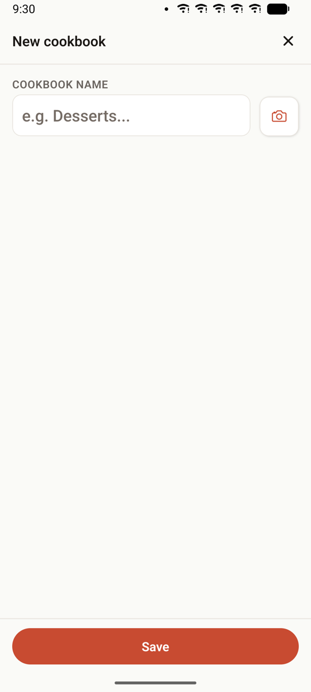

- **Co widzę:** A 'New cookbook' form with a 'COOKBOOK NAME' text box showing the placeholder 'e.g. Desserts...', a small camera button next to it, and a big red Save button at the bottom.
- **Czego oczekuję:** Tapping the text box will bring up the keyboard so I can type the name.
- **Co robię:** I'm tapping the name box to type the cookbook name.
- **Potrzeba:** Create a separate cookbook named "Mum's 60th – Family Recipes".
- **Akcja:** `{"type":"tap","x":228,"y":200}` → stuknięcie w (228, 200)

## shot-003

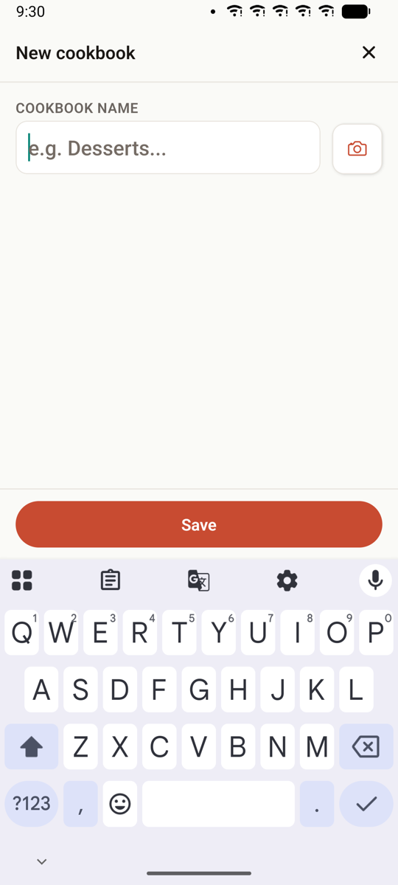

- **Co widzę:** The name box is focused with the keyboard open. The box is empty, showing the placeholder 'e.g. Desserts...'. The red Save button is above the keyboard.
- **Czego oczekuję:** Typing will put the cookbook name in the box.
- **Co robię:** I'm typing the name of the cookbook, Mum's 60th – Family Recipes. I can only use a plain hyphen for the dash.
- **Potrzeba:** Create the separate cookbook named "Mum's 60th – Family Recipes".
- **Akcja:** `{"type":"type","text":"Mum's 60th - Family Recipes"}` → wpisano tekst: Mum's 60th - Family Recipes

## shot-004

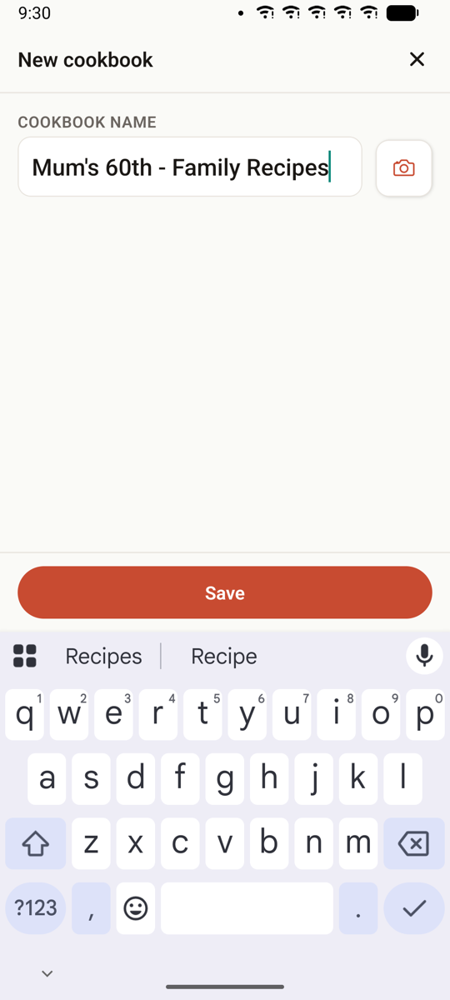

- **Co widzę:** The name box now says 'Mum's 60th - Family Recipes'. The big red Save button is just above the keyboard.
- **Czego oczekuję:** Tapping Save will create the cookbook and take me back to the list of cookbooks, or into the new empty cookbook.
- **Co robię:** I'm tapping the red Save button to save the cookbook name.
- **Potrzeba:** Need 1: create the separate cookbook 'Mum's 60th - Family Recipes'.
- **Akcja:** `{"type":"tap","x":270,"y":711}` → stuknięcie w (270, 711)

## shot-005

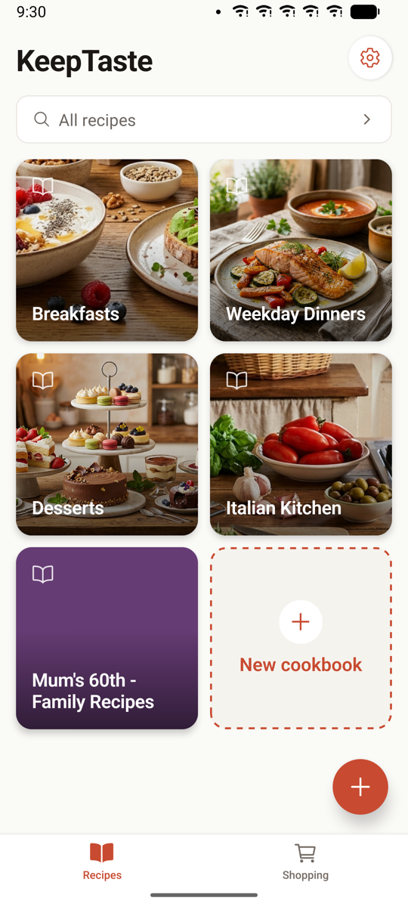

- **Co widzę:** The home screen now shows a purple tile 'Mum's 60th - Family Recipes' next to 'New cookbook'. It saved.
- **Czego oczekuję:** Tapping the new tile will open the empty cookbook, where I can add Auntie Carol's trifle.
- **Co robię:** I'm tapping the purple Mum's 60th tile to open it.
- **Co mnie zaskoczyło:** Nice, it's there. The dash is a plain hyphen, which is fine.
- **Potrzeba:** Need 1 and 2: get the new cookbook set up and add the trifle to it.
- **Akcja:** `{"type":"tap","x":141,"y":844}` → stuknięcie w (141, 844)

## shot-006

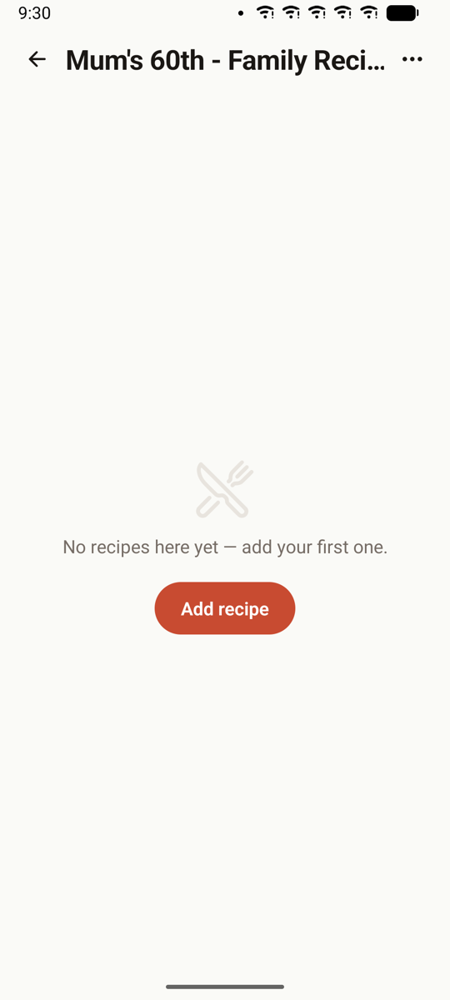

- **Co widzę:** The empty Mum's 60th cookbook with a message 'No recipes here yet' and a red 'Add recipe' button in the middle.
- **Czego oczekuję:** Tapping Add recipe will let me enter Auntie Carol's trifle, probably by pasting text from the message.
- **Co robię:** I'm tapping the red 'Add recipe' button to put in the trifle first.
- **Potrzeba:** Add Auntie Carol's trifle to the new cookbook.
- **Akcja:** `{"type":"tap","x":270,"y":730}` → stuknięcie w (270, 730)

## shot-007

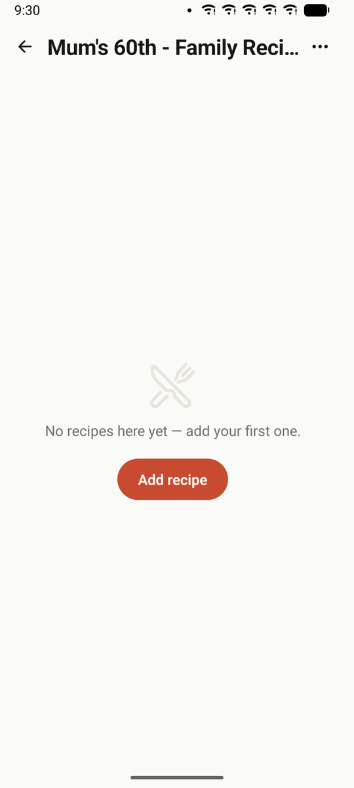

- **Co widzę:** The screenshot still shows the empty Mum's 60th cookbook with the Add recipe button. The list of texts, though, looks like a 'New recipe' form with an 'Import from a link, text or photo' option, so the screen may be mid-change.
- **Czego oczekuję:** The screen will finish changing to the New recipe form, where I can paste Emma's trifle text.
- **Co robię:** I'm waiting a moment for the screen to settle before I tap anything.
- **Co mnie zaskoczyło:** The picture and the text list don't match, so I'm not sure which screen I'm actually on.
- **Potrzeba:** Adding Auntie Carol's trifle to the Mum's 60th cookbook.
- **Akcja:** `{"type":"wait"}` → odczekanie 3 s

## shot-008

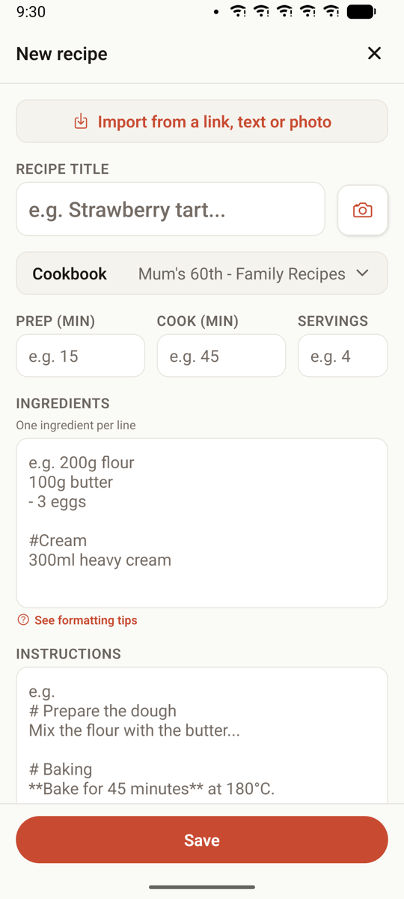

- **Co widzę:** The New recipe form is showing now, with the Cookbook already set to Mum's 60th - Family Recipes. Empty fields for title, ingredients and instructions. At the top there's an 'Import from a link, text or photo' button.
- **Czego oczekuję:** Tapping the title box will open the keyboard so I can type the trifle's name. I'll fill in the fields by hand, since the text is short enough.
- **Co robię:** I'm tapping the recipe title box to start typing 'Auntie Carol's Trifle'.
- **Co mnie zaskoczyło:** Good, the cookbook is already the right one, so I don't need to choose it.
- **Potrzeba:** Add Auntie Carol's trifle to the Mum's 60th cookbook.
- **Akcja:** `{"type":"tap","x":228,"y":279}` → stuknięcie w (228, 279)

## shot-009

- **Co widzę:** New recipe form with the title box still showing the placeholder 'e.g. Strawberry tart...'. No keyboard is visible, and the Cookbook is set to Mum's 60th. Ingredients and instructions boxes are empty.
- **Czego oczekuję:** Tapping the title box again will bring up the keyboard so I can type the name.
- **Co robię:** I'm tapping the recipe title box again, because the keyboard didn't appear and I want to type 'Auntie Carol's Trifle'.
- **Co mnie zaskoczyło:** The keyboard isn't showing even though I tapped the title box last time, so I'm not sure it was focused.
- **Potrzeba:** Need 2: add Auntie Carol's trifle to the Mum's 60th cookbook.
- **Akcja:** `{"type":"tap","x":228,"y":279}` → stuknięcie w (228, 279)

## shot-010

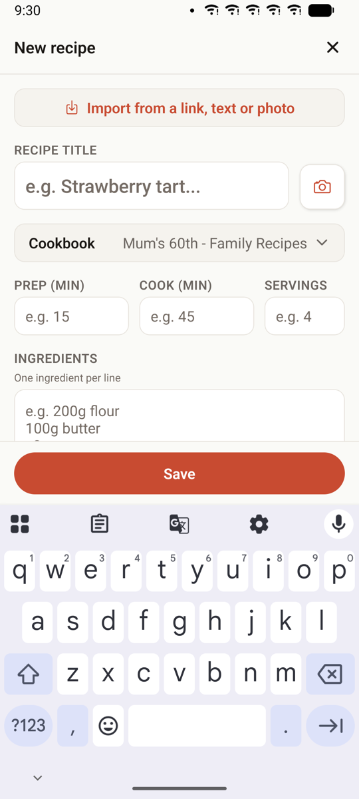

- **Co widzę:** The New recipe form with the keyboard open now. The title box still shows the placeholder, but the keyboard is up so it is probably focused. Cookbook is Mum's 60th.
- **Czego oczekuję:** Typing will put the recipe name into the title box.
- **Co robię:** I'm typing the recipe title, Auntie Carol's Trifle.
- **Co mnie zaskoczyło:** The keyboard has finally appeared after my second tap.
- **Potrzeba:** Need 2: add Auntie Carol's trifle to the new cookbook.
- **Akcja:** `{"type":"type","text":"Auntie Carol's Trifle"}` → wpisano tekst: Auntie Carol's Trifle

## shot-011

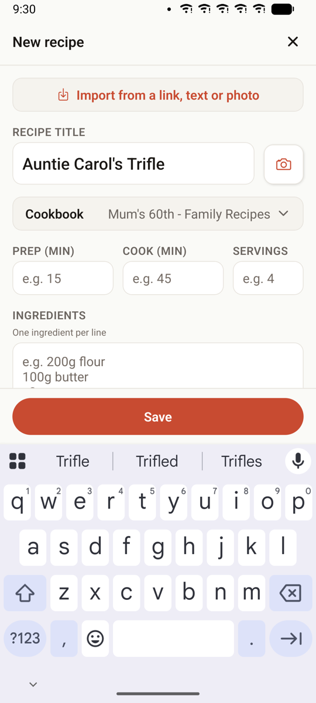

- **Co widzę:** The title box now says 'Auntie Carol's Trifle'. Cookbook is Mum's 60th. The ingredients box is partly hidden behind the keyboard, and the Save button is above the keyboard.
- **Czego oczekuję:** Tapping the ingredients box will let me type the ingredients from Emma's message.
- **Co robię:** I'm tapping the ingredients box, the white area under 'One ingredient per line', to type the trifle ingredients.
- **Potrzeba:** Adding Auntie Carol's trifle to the Mum's 60th cookbook.
- **Akcja:** `{"type":"tap","x":270,"y":625}` → stuknięcie w (270, 625)

## shot-012

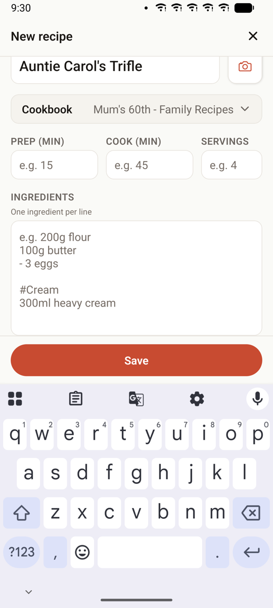

- **Co widzę:** The New recipe form with the keyboard open. The ingredients box shows grey placeholder text (e.g. 200g flour...). Title says Auntie Carol's Trifle, cookbook is Mum's 60th. It looks like the ingredients box may be focused.
- **Czego oczekuję:** Typing will put the trifle ingredients into the ingredients box, one per line.
- **Co robię:** I'm typing the ingredients from Emma's message into the ingredients box.
- **Co mnie zaskoczyło:** The box still shows the grey example text, so I can't be sure it's focused, but the keyboard is up.
- **Potrzeba:** Add Auntie Carol's trifle to the Mum's 60th cookbook.
- **Akcja:** `{"type":"type","text":"1 packet trifle sponges (8)\n3 tbsp sherry\n400 g frozen raspberries, thawed\n1 packet raspberry jelly\n500 ml ready-made custard\n300 ml double cream\n1 tbsp icing sugar\nflaked almonds to finish"}` → wpisano tekst: 1 packet trifle sponges (8)
3 tbsp sherry
400 g frozen raspberries, thawed
1 packet raspberry jelly
500 ml ready-made custard
300 ml double cream
1 tbsp icing sugar
flaked almonds to finish

## shot-013

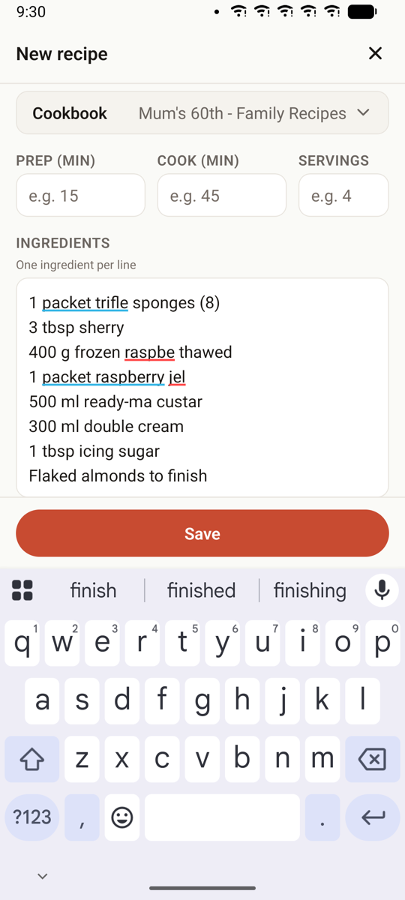

- **Co widzę:** The ingredients box now has my typed text, but some lines look garbled: 'raspbe thawed', 'jel', 'ready-ma custar'. The first letter of 'Flaked' got capitalised. The box seems to scroll, so the text may be cut off in the display. Save button is above the keyboard.
- **Czego oczekuję:** The text may be fine and just wrapped oddly; I'll scroll within the box to check, but the screen is cramped, so I'll check the box first.
- **Co robię:** I'm scrolling down a little to see the instructions box below, since I still need to add the method. The ingredients look slightly off, but I'll check them after.
- **Co mnie zaskoczyło:** Some words in the ingredients look cut short ('raspbe', 'jel', 'custar'), which worries me. I typed them in full.
- **Potrzeba:** Add Auntie Carol's trifle recipe to the Mum's 60th cookbook.
- **Akcja:** `{"type":"scroll","direction":"down"}` → przewinięcie (down)

## shot-014

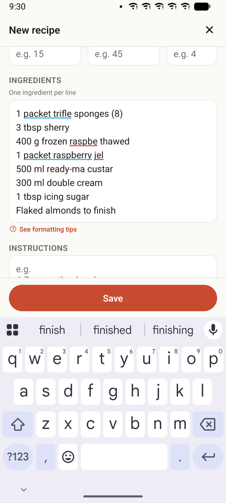

- **Co widzę:** The ingredients box shows my list, but three lines are cut short: 'raspbe thawed', 'jel' and 'ready-ma custar'. The Instructions box is just peeking out above the Save button.
- **Czego oczekuję:** Tapping the Instructions box will let me type the method from Emma's message.
- **Co robię:** I'm tapping the Instructions box to type the method first. I'll deal with the garbled ingredient words afterwards.
- **Co mnie zaskoczyło:** Words are missing letters even though I typed them in full, which worries me for a gift cookbook.
- **Potrzeba:** Add Auntie Carol's trifle to Mum's 60th cookbook.
- **Akcja:** `{"type":"tap","x":270,"y":638}` → stuknięcie w (270, 638)

## shot-015

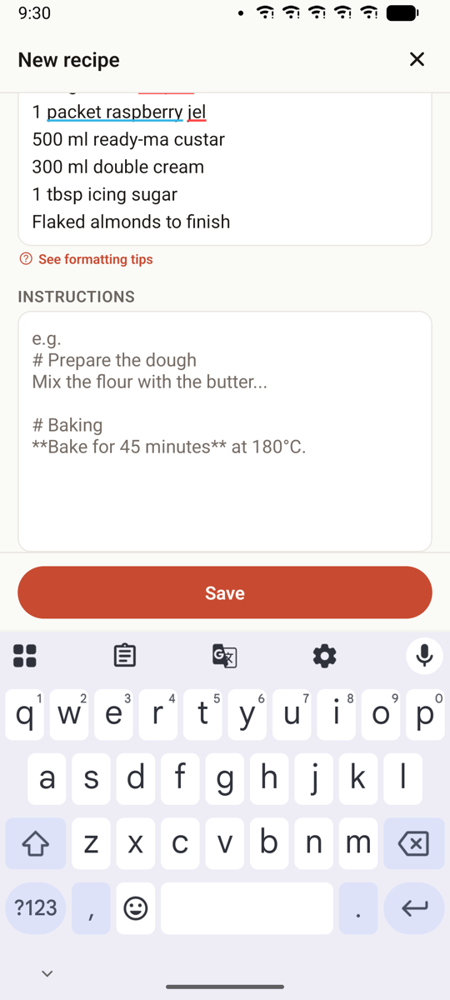

- **Co widzę:** The form scrolled; the ingredients box above shows my list with some words cut short ('jel', 'ready-ma custar'). The Instructions box is empty with grey example text, keyboard is open. Save button above the keyboard.
- **Czego oczekuję:** If the Instructions box is focused, typing will put the method in it.
- **Co robię:** I'm typing the method from Emma's message into the Instructions box. I'll check the ingredients afterwards.
- **Co mnie zaskoczyło:** The ingredients still look cut off, which is worrying, but it might just be a display thing.
- **Potrzeba:** Add Auntie Carol's trifle to Mum's 60th cookbook.
- **Akcja:** `{"type":"type","text":"Break sponges into a glass bowl and drizzle with sherry. Scatter raspberries over. Make up the jelly with 500 ml water, pour over and chill until set (about 3 hours). Spread custard on top. Whip cream with icing sugar to soft peaks, spoon over, sprinkle with almonds. Chill until serving."}` → wpisano tekst: Break sponges into a glass bowl and drizzle with sherry. Scatter raspberries over. Make up the jelly with 500 ml water, pour over and chill until set (about 3 hours). Spread custard on top. Whip cream

## shot-016

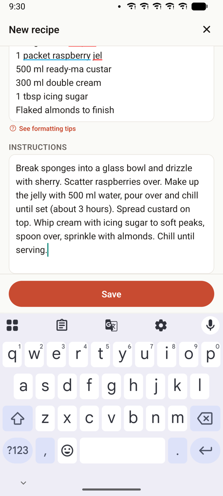

- **Co widzę:** The instructions box now holds the whole method from Emma's message, ending with 'Chill until serving.' Above it the ingredients box still shows 'ready-ma custar' and 'jel', which look cut short. The red Save button is above the keyboard.
- **Czego oczekuję:** Tapping Save will put the trifle into Mum's 60th cookbook. I'm worried about the short words, but I'm in a hurry on the tram and the gaps might just be the display.
- **Co robię:** I'm tapping the red Save button so the recipe is kept and I don't lose it. I'll open it afterwards to check whether the ingredients are really cut short.
- **Co mnie zaskoczyło:** The ingredients still look cut short ('jel', 'ready-ma custar'), which I don't like for a gift. The instructions came out in full.
- **Potrzeba:** Need 2: getting Auntie Carol's trifle into the Mum's 60th cookbook.
- **Akcja:** `{"type":"tap","x":270,"y":711}` → stuknięcie w (270, 711)

## shot-017

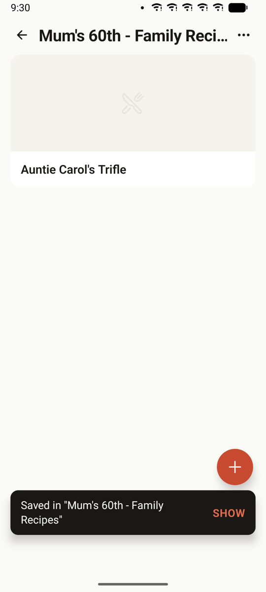

- **Co widzę:** The Mum's 60th cookbook now shows one tile, Auntie Carol's Trifle, and a message at the bottom saying 'Saved in Mum's 60th - Family Recipes' with a SHOW button.
- **Czego oczekuję:** The trifle is saved. I still need to move Mum's shepherd's pie and Granny's Victoria sponge in here, but I don't know where they are. I'll open the trifle first to check the ingredients that looked cut short.
- **Co robię:** I'm tapping the Auntie Carol's Trifle tile to open it and see whether the ingredients are really cut short.
- **Co mnie zaskoczyło:** Pleased it saved and there's a clear message. Still no photo, but that's fine.
- **Potrzeba:** Checking the trifle is saved correctly, so it can go in the book.
- **Akcja:** `{"type":"tap","x":270,"y":343}` → stuknięcie w (270, 343)

## shot-018

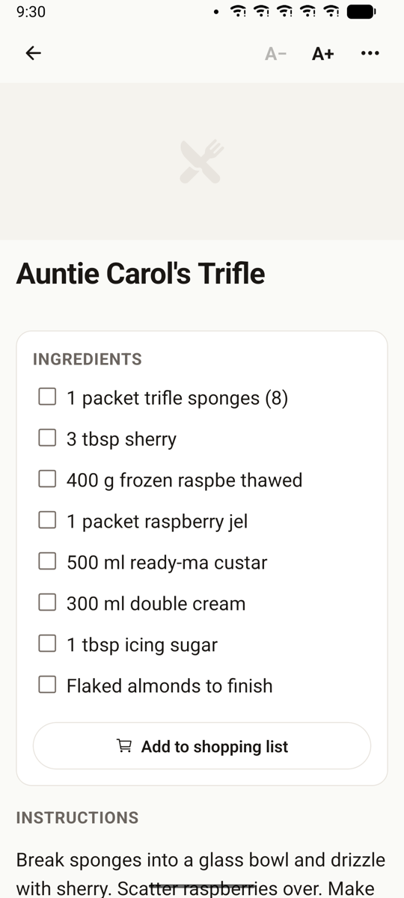

- **Co widzę:** The saved trifle recipe. Ingredients are really cut short: '400 g frozen raspbe thawed', '1 packet raspberry jel', '500 ml ready-ma custar'. In the method, '(about 3 hours)' shows as '(about )'. The three dots menu is top right.
- **Czego oczekuję:** The ... menu may have edit, move or share options. I need to fix the text and also find how to move the other recipes in here.
- **Co robię:** I'm tapping the three dots at the top right to look for Edit, since the recipe has wrong words and I don't want a gift cookbook with typos.
- **Co mnie zaskoczyło:** Words are missing letters, and '3 hours' turned into a strange box symbol. I typed it all properly, so I'm worried and a bit annoyed.
- **Potrzeba:** Getting Auntie Carol's trifle into the book correctly.
- **Akcja:** `{"type":"tap","x":494,"y":71}` → stuknięcie w (494, 71)

## shot-019

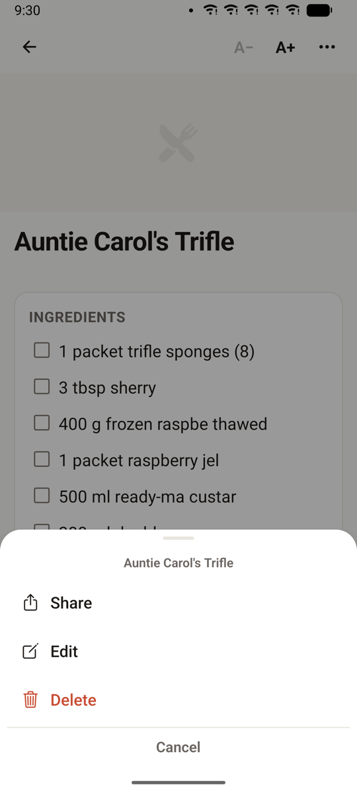

- **Co widzę:** A bottom menu with Share, Edit, Delete and Cancel over the trifle recipe. The ingredients behind still show 'raspbe thawed', 'jel', 'ready-ma custar'.
- **Czego oczekuję:** Tapping Edit will open the form again so I can fix the cut-off words.
- **Co robię:** I'm tapping Edit to correct the garbled ingredients so the gift cookbook has no typos.
- **Co mnie zaskoczyło:** Nothing new, but still annoyed the letters went missing when I typed them in full.
- **Potrzeba:** Get Auntie Carol's trifle into the book correctly.
- **Akcja:** `{"type":"tap","x":97,"y":985}` → stuknięcie w (97, 985)

## shot-020

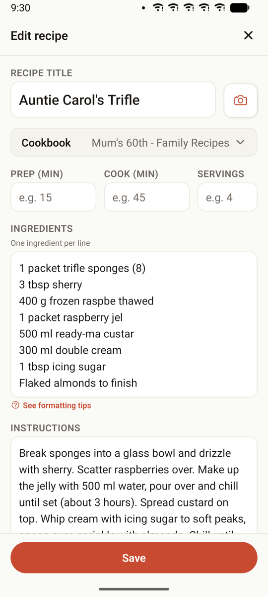

- **Co widzę:** The Edit recipe form for the trifle. The ingredients box still shows 'raspbe thawed', 'jel' and 'ready-ma custar'. The Save button is at the bottom.
- **Czego oczekuję:** I'd have to retype those lines and then somehow find my shepherd's pie and Victoria sponge and move them over. After that I'd still have to work out the PDF.
- **Co robię:** I'm giving up for now. I only have a few minutes before my stop, and this is getting fiddly: the letters went missing even though I typed everything in full. I'll sort it out at home on the laptop.
- **Co mnie zaskoczyło:** The cut-off words are still there, and '3 hours' showed up as a strange box symbol on the recipe page. I don't trust it for a gift cookbook.
- **Potrzeba:** Getting the trifle into the book correctly, then moving the other recipes and finding a PDF option.
- **Akcja:** `{"type":"give_up","reason":"I made the cookbook and saved the trifle in it, but some ingredient words came out cut short ('raspbe', 'jel', 'ready-ma custar') and '3 hours' turned into a box symbol. I haven't found how to move my shepherd's pie and Victoria sponge in, or whether I can get a PDF to print. It's too fiddly on a crowded tram, so I'll finish at home on the laptop."}` → give_up

